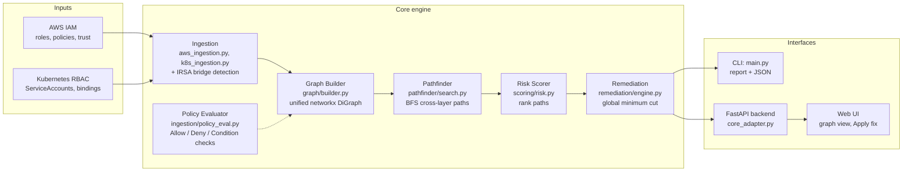
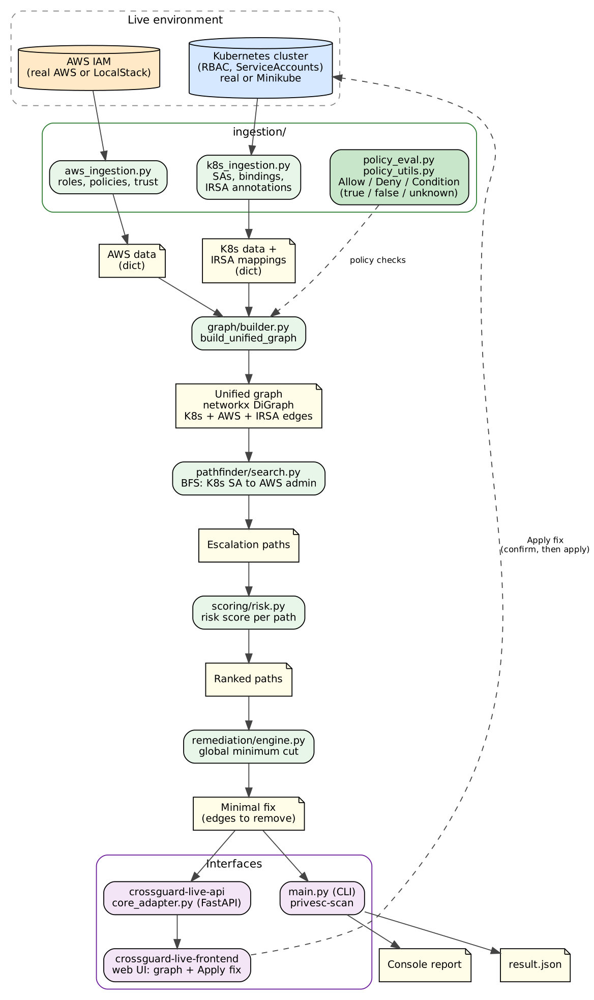

# CrossGuard: Unified Cross-Layer Privilege Escalation Analysis and Remediation Framework

A research tool that unifies AWS IAM and Kubernetes RBAC into a single
directed graph, discovers privilege-escalation paths that cross from
Kubernetes into AWS (via IRSA), and computes the minimum permission
change needed to break each path.

## Why this exists

Existing IAM privilege-escalation tools (PMapper, TAC, CloudLens,
SkyEye, Cloudsplaining, Pacu) only analyze AWS IAM. None of them read
Kubernetes RBAC, and none of them model IRSA (IAM Roles for Service
Accounts) as a graph edge. This means a real, exploitable attack path
like:

Pod -> ServiceAccount (IRSA-annotated) -> AWS IAM Role -> AdministratorAccess

is invisible to every one of them. This tool finds it.

## Novel contributions

1. **Unified cross-layer graph** -- Kubernetes RBAC and AWS IAM entities in one `networkx.DiGraph`.
2. **IRSA modeled as a graph edge** -- the `eks.amazonaws.com/role-arn` annotation becomes a directed edge from a K8s ServiceAccount to an AWS IAM role.
3. **Cross-layer path discovery** -- BFS traversal finds escalation paths that start in Kubernetes and end at AWS admin.
4. **Minimal remediation** -- a global minimum edge cut (via super-source/super-sink reduction) computes the smallest set of permission changes that breaks every found path simultaneously.

## Requirements

To run the tool itself:

- Python 3.10 or newer (developed and tested on Python 3.12)
- Python libraries, installed automatically by `pip install -e .`: boto3, kubernetes, networkx, matplotlib
- Read access to the AWS account to scan (`iam:List*`, `iam:Get*`) and to the Kubernetes cluster
  (ServiceAccounts, Roles, RoleBindings, ClusterRoles and ClusterRoleBindings in all namespaces)

To reproduce the benchmarks locally (no AWS account needed):

- Docker, which runs LocalStack 4.14.0 (a local fake AWS)
- Minikube (tested with v1.38.1) and `kubectl`, for a local Kubernetes cluster
- `awscli-local`, which provides the `awslocal` command used by the benchmark setup scripts
  (install it in a separate virtual environment, see below, so it does not change this project's pinned boto3)

To run the web interface (CrossGuard Live): FastAPI, uvicorn and pydantic, listed in
`crossguard-live-api/requirements.txt` (use a separate virtual environment).

## Installation

```bash
git clone https://github.com/niketkrishnan/CROSSGUARD
cd CROSSGUARD
python3 -m venv venv
source venv/bin/activate
pip install -e .
```

This installs the `privesc-scan` command.

## Quick start (default settings)

With all defaults (strict policy evaluation, region `us-east-1`, kubeconfig from `~/.kube/config`,
AWS credentials from the default credential chain):

Against real AWS + a real/in-context Kubernetes cluster:

```bash
privesc-scan --aws-profile my-profile
```

Against LocalStack (local fake AWS) + Minikube, for testing:

```bash
privesc-scan --endpoint-url http://localhost:4566
```

Write the full structured result to JSON as well:

```bash
privesc-scan --endpoint-url http://localhost:4566 --output-json result.json
```

All options:

```bash
privesc-scan --help
```

## Advanced usage

### Command-line options

| Option | Default | What it does |
|---|---|---|
| `--aws-profile NAME` | default credential chain | Named AWS CLI profile to use |
| `--endpoint-url URL` | real AWS | AWS endpoint; `http://localhost:4566` targets LocalStack |
| `--region REGION` | `us-east-1` | AWS region |
| `--kube-config PATH` | `~/.kube/config` | Kubeconfig file to read |
| `--in-cluster` | off | Use the pod's own ServiceAccount instead of a kubeconfig (run inside Kubernetes) |
| `--semantics {strict,annotate,legacy}` | `strict` | Policy evaluation mode (see below) |
| `--oidc-provider-arn ARN` | not set | Only treat an IRSA trust as `valid` if the role trusts exactly this OIDC provider |
| `--output-json PATH` | not set | Also write the full result as JSON |

### Examples

```bash
# Scan a real account with a named profile, region and kubeconfig
privesc-scan --aws-profile prod --region eu-west-1 --kube-config ~/.kube/prod-config

# Run inside a cluster (uses the pod's ServiceAccount, no kubeconfig)
privesc-scan --in-cluster

# Only accept IRSA trust from your cluster's own OIDC provider
privesc-scan --oidc-provider-arn arn:aws:iam::123456789012:oidc-provider/oidc.eks.eu-west-1.amazonaws.com/id/EXAMPLE

# Save the full result (paths, confidence, suppressed edges, remediation) as JSON
privesc-scan --endpoint-url http://localhost:4566 --output-json result.json

# Compare policy evaluation modes
privesc-scan --endpoint-url http://localhost:4566 --semantics legacy
```

### Policy evaluation modes (`--semantics`)

| Mode | Behaviour |
|---|---|
| `strict` (default) | Evaluates Deny, Conditions, PassRole pairing and wildcard trust, and drops edges that are definitely unusable (for example an IRSA link whose trust policy does not allow the ServiceAccount). Every drop is logged with a reason (`suppressed_edges` in the JSON output). |
| `annotate` | Same checks, but keeps every edge and only labels its confidence. |
| `legacy` | Presence-only behaviour with no policy checks. Used to reproduce the early benchmark results. |

### Reading the output

Each finding shows the escalation path, a risk score, a confidence label (`confirmed`, `potential` or
`unresolved`) and the minimal fix with a command.

## Architecture



| Module | File | Responsibility |
|---|---|---|
| Ingestion | `ingestion/aws_ingestion.py`, `ingestion/k8s_ingestion.py` | Pull AWS IAM + K8s RBAC data, detect IRSA bridge mappings |
| Policy evaluation | `ingestion/policy_eval.py`, `ingestion/policy_utils.py` | Policy parsing helpers and a three-valued (true / false / unknown) evaluator: Deny, Conditions, IRSA trust, PassRole pairing, wildcard trust |
| Graph Builder | `graph/builder.py` | Build the unified cross-layer `DiGraph` |
| Pathfinder | `pathfinder/search.py` | BFS search for cross-layer escalation paths |
| Risk Scorer | `scoring/risk.py` | Rank found paths by severity |
| Remediation | `remediation/engine.py` | Global minimum-cut remediation recommendations |

## How it all fits together

Data flows top to bottom. Rounded boxes are code, folded-corner boxes are the data passed between them, and the
dashed line is the one write-back: **Apply fix** in the web UI changes the live environment after a confirm step.

[](docs/crossguard-overview.png)

### Description of files

Core pipeline:

| File | Input | Output |
|---|---|---|
| `ingestion/aws_ingestion.py` | AWS credentials or role | IAM roles, policies, trust relationships |
| `ingestion/k8s_ingestion.py` | kubeconfig or in-cluster identity | ServiceAccounts, RBAC bindings, IRSA annotations |
| `ingestion/policy_eval.py`, `ingestion/policy_utils.py` | A policy and a request | Allow / Deny / unknown (Conditions, IRSA trust, PassRole pairing) |
| `graph/builder.py` | AWS data, K8s data | One unified `networkx.DiGraph` with IRSA bridge edges |
| `pathfinder/search.py` | The graph | Cross-layer escalation paths |
| `scoring/risk.py` | Paths | Risk score per path, ranked |
| `remediation/engine.py` | Paths | Minimal set of edges to remove (global minimum cut) |

Interfaces and supporting folders:

| Path | Purpose |
|---|---|
| `main.py` | CLI entry point (`privesc-scan`): report and optional `--output-json` |
| `crossguard-live-api/` | FastAPI backend; `app/core_adapter.py` calls the same engine as the CLI |
| `crossguard-live-frontend/` | Single-file web UI: graph view and Apply fix |
| `benchmarks/` | Setup scripts and expected results for B1 to B11 |
| `evaluation/` | Evidence trail and experiment scripts |
| `tests/` | pytest suite |

## Code organization

| Folder / file | Role |
|---|---|
| `ingestion/`, `graph/`, `pathfinder/`, `scoring/`, `remediation/` | Core engine (source code), one folder per pipeline stage |
| `main.py` | CLI entry point (`privesc-scan`) that chains the stages |
| `crossguard-live-api/`, `crossguard-live-frontend/` | Web app: FastAPI backend + single-file graph UI, wrapping the same engine |
| `benchmarks/` | Data: benchmark environments with documented ground truth |
| `evaluation/` | Experiments: scalability, real-world, baselines, remediation trials |
| `tests/` | Unit tests (118) |
| `paper/` | Research paper sources |

## Running the test suite

```bash
pip install -e ".[dev]"
pytest tests/ -v
```

118 tests (plus 1 optional PMapper-comparison test, skipped unless principalmapper is installed), covering policy parsing, ingestion (against mocked AWS/K8s
clients), graph construction, pathfinding, risk scoring, and
remediation (including a global-minimum-cut correctness test that
caught a real per-path-cut deduplication bug during development).

## Reproducing the benchmarks locally

Requires Docker (for LocalStack) and Minikube (for a local Kubernetes
cluster).

```bash
# 0. One-time: install awslocal (used by the benchmark setup scripts) in a separate
#    environment so it does not change this project's pinned boto3
python3 -m venv ~/awsvenv && ~/awsvenv/bin/pip install awscli awscli-local
mkdir -p ~/bin && ln -sf ~/awsvenv/bin/awslocal ~/bin/awslocal && ln -sf ~/awsvenv/bin/aws ~/bin/aws
export PATH=$PATH:$HOME/bin

# 1. Start LocalStack (local fake AWS, no account/token needed)
docker run -d --name localstack -p 4566:4566 localstack/localstack:4.14.0

# 2. Start Minikube (local real Kubernetes cluster)
minikube start --driver=docker

# 3. Set AWS env vars to point at LocalStack
export AWS_DEFAULT_REGION=us-east-1
export AWS_ACCESS_KEY_ID=test
export AWS_SECRET_ACCESS_KEY=test

# 4. Set up Benchmark 1
./benchmarks/bench1/setup_aws.sh
kubectl create serviceaccount vulnerable-sa -n default
kubectl annotate serviceaccount vulnerable-sa -n default \
  eks.amazonaws.com/role-arn=arn:aws:iam::000000000000:role/admin-role
kubectl apply -f benchmarks/bench1/test-pod.yaml

# 5. Run the tool
privesc-scan --endpoint-url http://localhost:4566
```

Expected output: 1 cross-layer escalation path
(`vulnerable-sa --[irsa_bridge]--> admin-role`, risk score 6.0), with a
remediation recommendation to remove the IRSA annotation.

See `benchmarks/bench1/README.md` for the documented ground truth.

To run another benchmark, reset the environment first with `./benchmarks/reset_environment.sh`, then
follow that benchmark's README or setup script.

Benchmarks 2 and 8 to 11 were written before the IRSA trust check existed: their setups give the IRSA roles
an EC2 (or no OIDC) trust, so run them with `privesc-scan --endpoint-url http://localhost:4566 --semantics legacy`.
Under the default `strict` mode the tool correctly drops those IRSA edges and reports no path.
Benchmarks 1, 3, 5 and 6 use a realistic OIDC trust and work in every mode.

**Note:** LocalStack does not persist IAM resources across container
restarts. If you stop/restart the container, rerun
`./benchmarks/bench1/setup_aws.sh` before scanning again.

## Web interface (CrossGuard Live)

The CLI above is the core tool. There is also a web application built on
top of the same engine -- a FastAPI backend that wraps `ingest_aws`,
`ingest_k8s`, `build_unified_graph`, `find_all_cross_layer_paths`,
`score_all_paths`, and `find_minimum_remediation` behind an HTTP API, and
a single-file browser frontend that visualizes the graph and lets you
apply a remediation with one click.

```
crossguard-live-api/       FastAPI backend -- scan orchestration + REST API
crossguard-live-frontend/  Single-file HTML/JS graph visualizer
```

The web app does not duplicate any analysis logic -- `crossguard-live-api/app/core_adapter.py`
is a thin bridge that imports and calls the exact same functions used by
`main.py` above. Same engine, same benchmarks apply, same results.

**Quick start:**

```bash
cd crossguard-live-api
pip install -r requirements.txt
export PYTHONPATH=..:$PYTHONPATH
export CROSSGUARD_API_KEY=$(python3 -c "import secrets; print(secrets.token_urlsafe(32))")
uvicorn app.main:app --reload
```

Then open `crossguard-live-frontend/index.html` in a browser, enter the
API URL + key, and run a scan. Use a separate virtual environment for the web
app, because its pinned dependencies differ from the CLI's. The scan form has an
**Analysis mode** dropdown (strict by default, annotate, legacy) that matches
the CLI's `--semantics`. See `crossguard-live-api/README.md` for
full setup (including the IAM trust policy needed to let it assume a
role) and deployment instructions.

**Security model:** no raw AWS credentials or kubeconfigs are ever
stored -- only `sts:AssumeRole` against a role you configure, held in
memory for one scan/apply and discarded. Applying a remediation is a
two-step confirm-then-apply flow with a single-use token. Full details
in `crossguard-live-api/README.md`.

## Comparison with existing tools

Running PMapper against the same benchmark environment finds 0
cross-layer paths, because PMapper has no Kubernetes awareness at all
-- it never reads RBAC, never sees the IRSA annotation, and therefore
cannot represent this attack path in any form.

## Evaluation & Results

**For a complete, case-by-case accounting of every benchmark used to
evaluate this tool — what each case is, why it exists, where it's
sourced from, how ground truth was established, and exact commands to
reproduce it — see [`BENCHMARK_CASE_CATALOG.md`](BENCHMARK_CASE_CATALOG.md).**
That is the authoritative reference for any question about case counts,
provenance, or methodology.

Full evaluation record, evidence trail, and reproducibility details live
in `evaluation_complete_final.md` (repo root), `evaluation/policy_semantics/POLICY_SEMANTICS_EVALUATION.md`
(policy-semantics fixes, the generated benchmark, real-world published
policies, baselines/ablations, and the risk-score decoupling proof), and
the `evaluation/` directory (`evaluation/README.md` is the index).
Highlights:

- Run against 11 live benchmarks (B1 to B11), covering vulnerable, safe and tricky configurations; see `benchmarks/` for each one.
- Real-world: 44/44 correct, 0 FP, 0 FN, across 6 independent extraction
  methods on real EKS repositories (`evaluation/real_world/RW_MANIFEST.md`
  for the full per-case table)
- Scalability: empirical exponent about 2.01 (R^2 > 0.98), up to 25,000 nodes
- PMapper and Cloudsplaining baseline comparisons, plus documented
  limitations (policy Condition evaluation and wildcard trust were
  limitations of the earlier version; strict mode now evaluates them, with
  unsupported cases reported as unresolved)

## Limitations

- **Admin check is simple.** A role counts as admin only if it has full `AdministratorAccess` or a policy that allows everything on everything. Extra AWS guardrails (SCPs, permission boundaries, session policies) are not checked, so the tool may report a path that those guardrails would actually block.
- **The scan needs read access to policies.** The account used for the scan must be allowed to read policies (`iam:GetPolicy`, `iam:GetPolicyVersion`). Without that, those policies are skipped with a warning, so some paths could be missed.
- **Kubernetes to AWS link.** A ServiceAccount is linked to an AWS role by its annotation. By default (`strict` mode) the tool also checks that the role's trust policy really lets that ServiceAccount in, and drops the link if it doesn't. It does not check the cluster's identity provider unless you pass `--oidc-provider-arn`. In `legacy` mode the annotation alone is trusted.
- **Policies are checked statically.** The tool reads the policy text and does not run anything. Common conditions are understood. Conditions it doesn't understand are reported as "unresolved" instead of being guessed.

## Citing

Archived on Zenodo (all versions): https://doi.org/10.5281/zenodo.23754688
